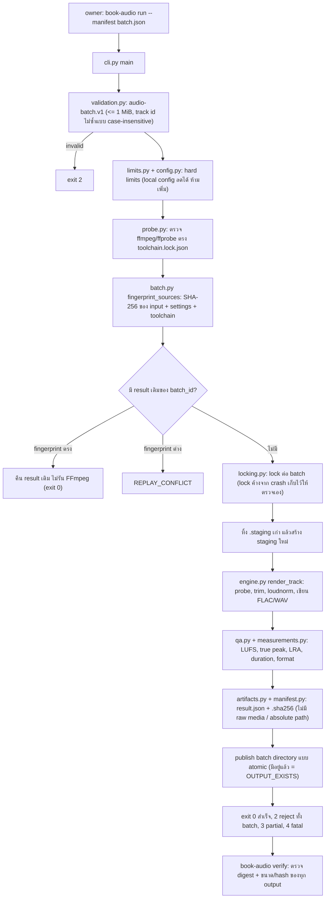
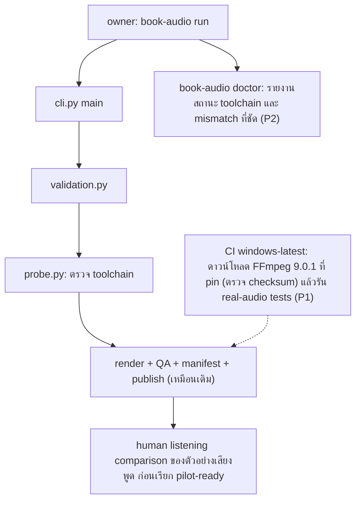

# 01 — Business process (As-Is / To-Be)

content-audio-mastering-cli (`book-audio`) คือ CLI ในเครื่องที่เตรียมไฟล์เสียงเป็น batch: ตัดตาม sample, ปรับ loudness ด้วย FFmpeg, ตรวจ QA เชิงตัวเลข แล้วเขียน FLAC / WAV 24-bit พร้อม `result.json` ที่ตรวจ hash ได้ ใช้โดย owner เพื่องานเสียงพูด/podcast ไม่มี AI และไม่มี hosted runtime

Last reviewed: 2026-11-28 · commit `06da65b`

## As-Is (จากโค้ดวันนี้)

Sources: `src/book_audio_production/cli.py`, `validation.py`, `limits.py`, `config.py`, `probe.py`, `toolchain_lock.py`, `batch.py` (`fingerprint_sources`, `process_batch_once`, `discard_incomplete_staging`, `_publish_batch_directory`), `engine.py` (`render_track`, `process_batch`), `qa.py`, `artifacts.py`, `manifest.py`, `replay.py`, `README.md`, `PRODUCT.md`

ข้อเท็จจริงสำคัญจากโค้ด:

- ไม่มีการเรียก LLM / transcription: ทุก result รายงาน `model_calls: 0`; ต้นทุนเป็นเงินรายงาน unknown เพราะไม่มี rate card
- FFmpeg/FFprobe ที่ pin เป็น Windows build: บน Linux CI test ที่ render เสียงจริงจะ skip (`.github/workflows/ci.yml`, coverage gate 58%)
- `book-audio benchmark` สร้าง tone สังเคราะห์ในเครื่องเพื่อวัดเวลา/ไบต์/replay (ไม่อยู่ในภาพ)

## To-Be (docs/UPGRADE-PLAN.md §Backlog; PRODUCT.md §Limits)

To-Be ที่เขียนไว้เป็นงานเสริมของกระบวนการเดิม ไม่ใช่กระบวนการใหม่:

Sources: `docs/UPGRADE-PLAN.md` §Backlog P0–P2, `PRODUCT.md` §Limits, `docs/engineering/2026-09-26-audio-listening-checklist.md`

## Gap

| ID | As-Is → To-Be | Status | Owner | Evidence |
|---|---|---|---|---|
| G1 | ยังไม่ยืนยันว่า GitHub Actions run แรกเขียว → CI เขียว | todo | claude | `docs/UPGRADE-PLAN.md` §Backlog P0 |
| G2 | real-audio tests skip บน Linux CI → job `windows-latest` ดาวน์โหลด FFmpeg ที่ pin แล้วรัน | todo | claude | `docs/UPGRADE-PLAN.md` §Backlog P1; `.github/workflows/ci.yml` |
| G3 | `batch.py` ยังไม่มี type annotations ครบ → strict mypy + Ruff `PTH`, `RET`, `C4` | todo | claude | `docs/UPGRADE-PLAN.md` §Backlog P1 |
| G4 | toolchain mismatch แสดงแค่ error code → คำสั่ง `book-audio doctor` | todo | claude | `docs/UPGRADE-PLAN.md` §Backlog P2 |
| G5 | QA เป็นตัวเลขอย่างเดียว → human listening comparison ก่อนเรียก pilot-ready | todo | owner | `PRODUCT.md` §Limits; `docs/engineering/2026-09-26-audio-listening-checklist.md` |
| G6 | tier และ lifecycle ใน roadmap `ai-labs` เป็น unknown → owner ตัดสิน lab หรือ product | decide | owner | `PRODUCT.md` §Disposition |
| G7 | ownership ระหว่าง CLI นี้กับ platform `audio_production` ไม่ชัด → แยก `audio-batch.v1` กับ `audio-ir.v1` | done | claude | `docs/UPGRADE-PLAN.md` §Done in this pass (pass 3); `README.md` §Ownership boundary |

## Open questions

- ผล GitHub Actions run ล่าสุดบน main [ต้องยืนยัน] (UPGRADE-PLAN ยังมี P0 ค้าง)
- ต้องการ rate card ในเครื่องเพื่อรายงานต้นทุนเป็นเงินหรือไม่ (ตอนนี้เป็น unknown เสมอ)
